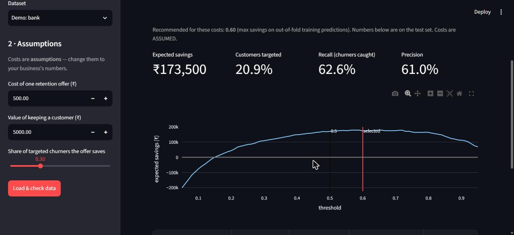
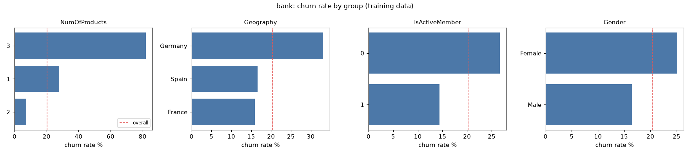
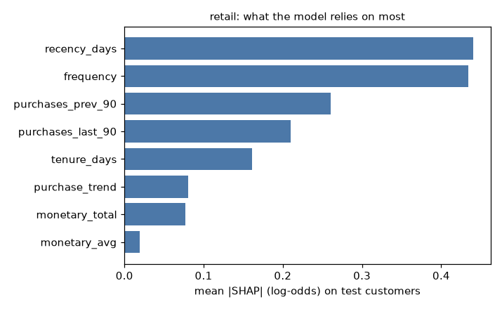
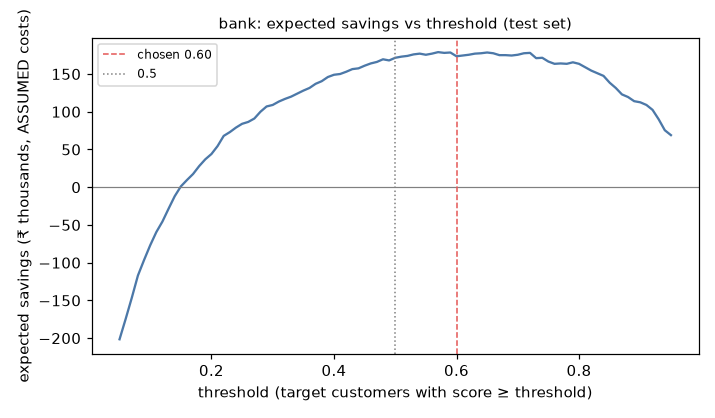
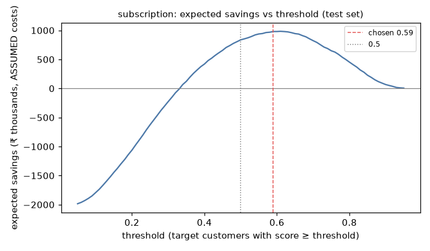

# ChurnLens

[](https://github.com/AM2004legend/ChurnLens/actions/workflows/ci.yml)

**One churn-analytics pipeline for any customer business.** Give it a labelled customer table or a
raw transaction log and it cleans the data, guards against leakage, explains who churns, compares
models, chooses a decision threshold from the business's own costs, explains each prediction with
SHAP, and groups at-risk customers into segments with suggested actions.

Proven unchanged on four public datasets from four industries — including one with **no churn
label**, where ChurnLens defines churn from inactivity and builds RFM features itself.



## Results (held-out test sets)

Model chosen by 5-fold CV PR-AUC on the training set; threshold chosen by expected savings on
out-of-fold training predictions; the test set is used once. **Rupee figures use ASSUMED costs**
(listed in each `configs/datasets/*.yaml`) — the method matters more than the amounts.

| dataset | mode | rows (train/test) | test churn rate | best model (CV PR-AUC) | test ROC-AUC | test PR-AUC | threshold | recall @ threshold | precision @ threshold | expected savings (₹, ASSUMED costs) | savings @0.5 | target everyone |
|---|---|---|---|---|---|---|---|---|---|---|---|---|
| bank | labelled | 8,000 / 2,000 | 20.3% | lightgbm | 0.856 | 0.700 | 0.60 | 62.6% | 61.0% | 173,500 | 171,500 | -389,500 |
| ecommerce | labelled | 4,503 / 1,127 | 16.9% | lightgbm | 0.943 | 0.830 | 0.19 | 85.8% | 65.7% | 97,100 | 94,600 | -54,400 |
| retail | transactions | 4,332 / 4,313 | 49.3% | logreg | 0.752 | 0.700 | 0.18 | 98.0% | 55.4% | 1,372,200 | 1,221,600 | 1,257,300 |
| subscription | labelled | 195,029 / 48,758 | 18.1% | logreg | 0.754 | 0.409 | 0.59 | 55.8% | 37.4% | 980,250 | 836,700 | -2,011,500 |

Full tables (model comparison, confusion matrices, SHAP drivers): [`reports/results.md`](reports/results.md).
Every number above is generated by `python -m churnlens.run --all` from files in `reports/`.

## What the pipeline does

| Step | Module | Key idea |
|---|---|---|
| Load + map | `io.py` | One YAML per dataset maps business columns to `customer_id`, `churn`, `date`, `amount`; clear errors with "did you mean…" hints |
| Clean | `schema.py` | Type detection, missing-value report, rule-based cleaning only — imputation happens inside the model Pipeline so it can't leak |
| Split | `features.py`, `transactions.py` | Stratified (or **grouped**, for duplicated customers) for tables; **time-based** for transactions |
| Leakage guard | `leakage.py` | Flags ID-like columns, single-feature AUC > 0.95 (out-of-fold for categoricals), outcome-like names, date columns, duplicated customer profiles — on the training split only |
| EDA | `eda.py` | Churn rate, strongest differences, 5 plain-English findings per dataset |
| Transactions mode | `transactions.py` | Churned = no purchase in (c, c+N]; recency, frequency, monetary, tenure, trend from data ≤ c; train at c₁, test at c₂ > c₁ |
| Models | `models.py` | Scaled logistic regression vs LightGBM, both class-weighted; 5-fold stratified CV; all of precision/recall/F1/ROC-AUC/PR-AUC/confusion matrix |
| Threshold | `threshold.py` | savings = Σ targeted (churner × success rate × value − offer cost); compared with target everyone / no one / 0.5 |
| Explain + segments | `explain.py`, `segments.py` | SHAP summed back to business columns; top-3 risk reasons per customer; segments by top driver with actions from a YAML rules table |

## Things the pipeline caught

- **Duplicated customers (ecommerce).** LightGBM first scored test ROC-AUC **0.9985**. ~66% of rows
  were near-copies of another customer (same cashback to the cent and same demographics, 98.7% same
  label), so a random split let the model memorise. Grouping copies on one side of the split gave an
  honest **0.943**. Logistic regression barely moved — the signature of memorisation.
- **Seasonality (retail).** Churn was 64% at the June cutoff but 49% at the September cutoff: the
  test label window covers the Christmas trade. A random split would have hidden this.
- **A cleaning bug.** De-duplicating retail lines *after* mapping dropped 331k different products that
  shared invoice, time and amount; de-duplicating on the full raw row drops 26k true duplicates.

## Inactivity-window sensitivity (retail)

Churn defined as N days without a purchase. Ranking quality is stable; churn rate, threshold and
savings move with N — the definition is a business choice.

| inactivity_days | train_cutoff | test_cutoff | train_churn_rate | test_churn_rate | best_model | test_roc_auc | test_pr_auc | threshold | recall | savings |
|---|---|---|---|---|---|---|---|---|---|---|
| 60 | 2011-08-11 | 2011-10-10 | 0.656 | 0.5603 | lightgbm | 0.7244 | 0.7427 | 0.09 | 0.9874 | 1704000.0 |
| 90 | 2011-06-12 | 2011-09-10 | 0.6413 | 0.4929 | logreg | 0.7518 | 0.6999 | 0.18 | 0.9802 | 1372200.0 |
| 120 | 2011-04-13 | 2011-08-11 | 0.5759 | 0.4647 | logreg | 0.7728 | 0.7095 | 0.24 | 0.9584 | 1270500.0 |

## Run it

```powershell
py -3.12 -m venv .venv
.\.venv\Scripts\Activate.ps1
pip install -r requirements-dev.txt
pytest; ruff check .                       # no datasets needed
python -m churnlens.run --dataset bank     # needs data/raw/bank.csv (see data/README.md)
python -m churnlens.run --all              # all four + reports/results.md (~2 minutes)
streamlit run app/streamlit_app.py         # app; synthetic demos work without any download
```

Datasets: see [`data/README.md`](data/README.md) for sources and licences. Raw data is never committed.

## Figures

| | |
|---|---|
|  |  |
|  |  |

## Honest limitations

- **Costs are assumptions.** Offer cost, customer value and success rate are made-up but plausible;
  the method matters more than the rupee figures.
- **Public datasets are partly synthetic or old.** The subscription data looks synthetic (almost
  perfectly uniform categories); the e-commerce data contains many duplicated customers; retail is
  2009–2011. Results show the method, not real-world performance.
- **Inactivity-based churn depends on the window** (see the 60/90/120-day table).
- **Explanations show what the model uses, not proven causes.** Suggested actions are illustrative
  rules, not tested interventions.
- **Scores are not calibrated probabilities** (class weighting shifts them up); thresholds are chosen
  empirically for that reason.
- No hyper-parameter tuning — a deliberate fair-baseline comparison.

## Project docs

[`docs/PRD.md`](docs/PRD.md) · [`PROGRESS.md`](PROGRESS.md) · [`DECISIONS.md`](DECISIONS.md) ·
[`docs/DEMO_SCRIPT.md`](docs/DEMO_SCRIPT.md)
